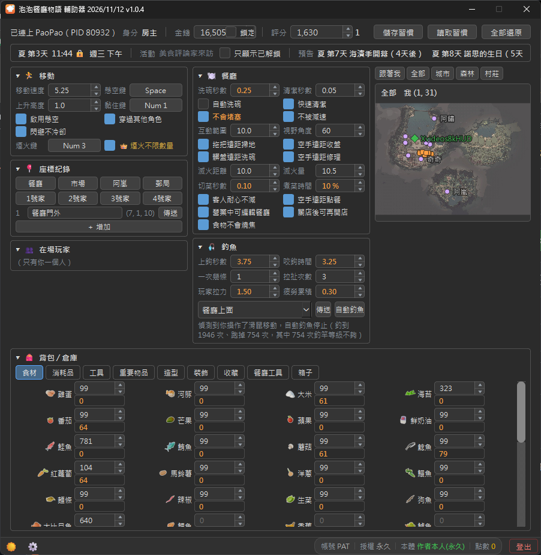

# 泡泡餐廳物語 輔助器

《泡泡餐廳物語》的輔助工具：金錢、背包與倉庫數量、餐廳打掃與遠距互動、移動、自動釣魚、釣魚點與座標傳送、在場玩家等。

## 預覽

## 下載

到 **[Releases（最新版）](https://github.com/a8761207/Trainer_PaoPao-Release/releases/latest)** 下載 `Trainer_PaoPao-v版本.exe`，直接執行即可，不用安裝。

## 使用需求

> [!IMPORTANT]
> - **所有資料和功能，一律要遊戲開著才能使用。**
> - **本工具不會連線到遊戲伺服器、不會傳送任何資料給遊戲伺服器，也不會修改遊戲的安裝檔案。**
> - **本工具是第三方輔助工具，與遊戲官方無關，請自行評估後使用。**
> - **本工具使用 AI 設計，不喜勿用。**

- Windows 10 / 11（64 位元）
- 需要授權帳號登入（第一次開啟可以註冊）
- 可以免費試用 2 小時（只計算程式開著的時間；同一個帳號、同一台電腦只能試用一次），之後要開通才能使用功能

## 第一次執行

- 執行檔沒有數位簽章，Windows 可能顯示「Windows 已保護您的電腦」：
  點「其他資訊」→「仍要執行」
- 每個版本的 Release 頁面都附 VirusTotal 掃毒報告；不放心的話，可以比對下載檔案的 SHA256 跟報告上的是否相同
  （PowerShell：`Get-FileHash 檔名`）

---

## 支持作者

喜歡這個工具的話，想支持作者，可以考慮加入 **[遊戲聯合公國 Discord](https://discord.gg/nTE6CBb)** 幫我們擴展人數。
這是一個廣納各種遊戲的交流社區，不侷限單一遊戲，族群偏向上班族較多，不想要加入的話也不勉強。

也可以透過 Ko-fi 贊助作者，你的支持是持續更新的動力：

